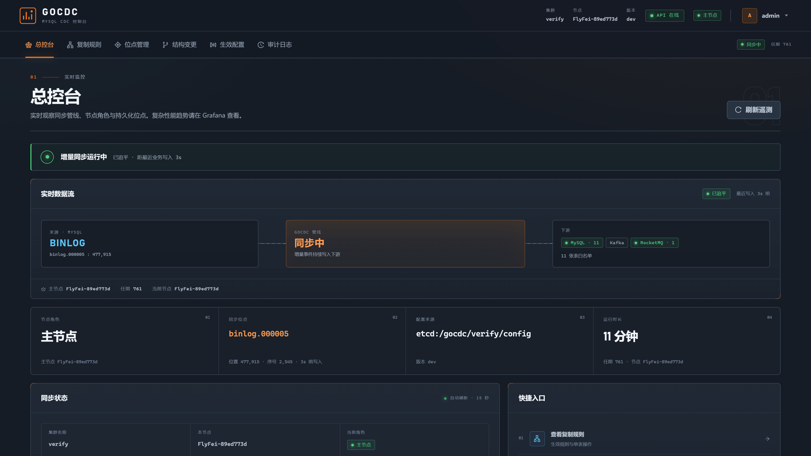
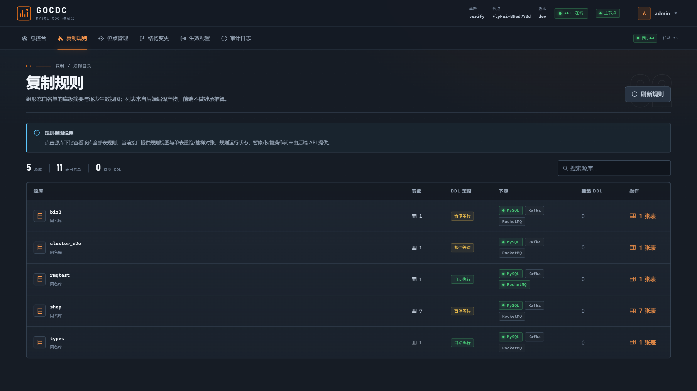
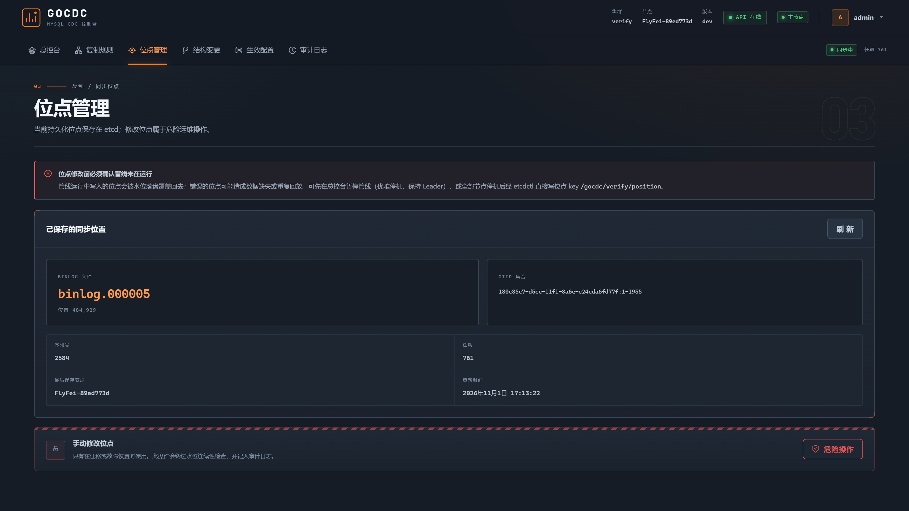
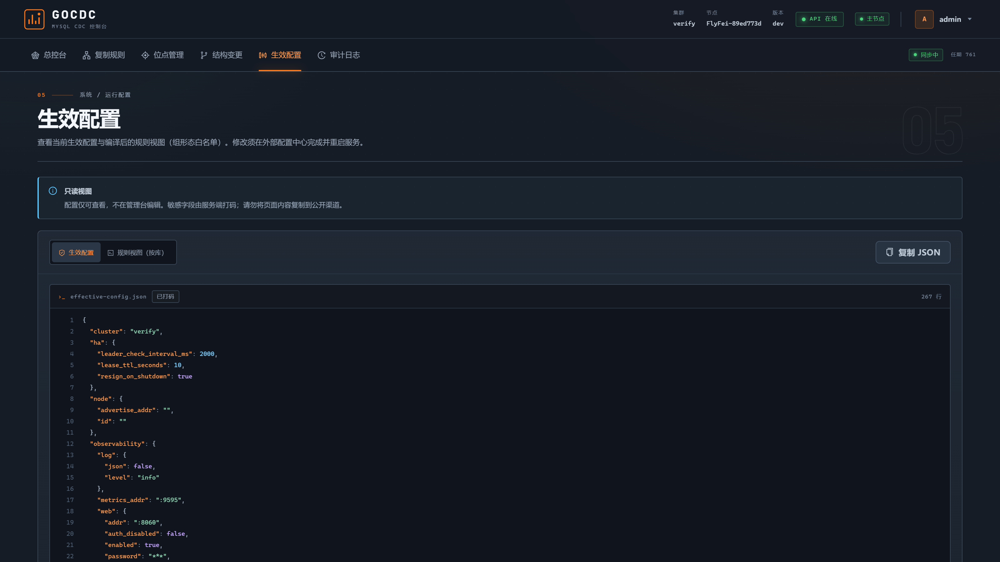
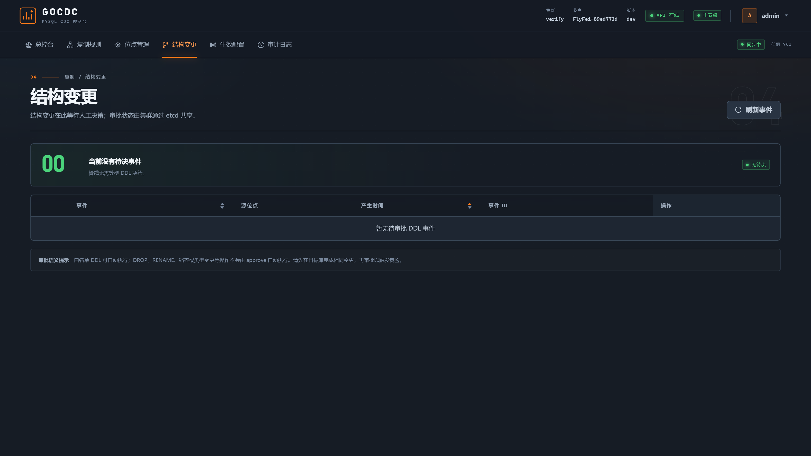

# gocdc-mysql

<p align="center">
  <b>MySQL CDC in a single Go binary — binlog → MySQL / Kafka / RocketMQ,<br>
  with built-in HA, DDL approval and field masking.</b>
</p>

<p align="center">
  English | <a href="README.zh-CN.md">简体中文</a>
</p>

<p align="center">
  <a href="#license"></a>
  
  
  <!-- TODO: uncomment once GitHub Actions CI + releases exist
  <a href="https://github.com/qingflyfei/gocdc-mysql/actions/workflows/ci.yml"></a>
  
  -->
</p>

<p align="center"></p>

---

## Why gocdc?

Existing MySQL CDC tools are either JVM-heavy (canal, Debezium, Flink CDC) or
single-machine Go tools without real HA, DDL handling or masking. gocdc is the
lightweight middle ground:

- **One Go binary, zero JVM** — the Web console is embedded (`go:embed`); deploy
  is a process, not a platform.
- **Built-in HA** — etcd leader election; if the leader is killed (`kill -9`), a
  hot standby takes over within lease TTL + 10s and **no events are lost**
  (positions live in etcd, MySQL sink is idempotent upsert).
- **Parallel pipeline with watermark positions** — binlog is parsed once and
  sharded by `schema.table` across N workers; strict per-table ordering, and the
  checkpoint only advances past fully-flushed events.
- **Full + incremental in one pass** — consistent snapshot (FTWRL /
  `LOCK INSTANCE FOR BACKUP`) with the binlog position captured at snapshot
  time, then seamless incremental catch-up; per-table completion marks survive
  restarts.
- **DDL with an approval flow** — `pause` (default: pipeline freezes, one-click
  approve in the Web console), `auto` (whitelist: ADD COLUMN / varchar expand /
  COMMENT), or `ignore`. Destructive DDL (DROP/RENAME) is always gated.
- **Field masking built in** — `phone` / `email` / `hash_md5` / `hash_sha256` /
  `truncate` / fixed / null, applied identically to snapshot and binlog rows.
- **Trust, then trust but verify** — at-least-once delivery with globally unique
  `event_id` for downstream dedup, plus a built-in sampled reconciliation API
  (`POST /api/v1/verify`).
- **Observable by default** — Prometheus `/metrics`, `/healthz`, `/readyz`,
  bundled Grafana dashboard + alert rules, embedded Web console.

## Quickstart (60 seconds)

Prereqs: Docker with Compose. That's it.

```bash
git clone --depth 1 https://github.com/qingflyfei/gocdc-mysql.git
cd gocdc-mysql/deploy
docker compose up -d          # etcd + MySQL(source) + MySQL(target) + gocdc
docker compose ps             # wait until healthy
```

**1. Write to the source database**

```bash
docker compose exec mysql-src mysql -uroot -p123456 -e \
  "INSERT INTO demo.orders (user_id, amount, remark, phone) VALUES (1, 9.90, 'hello', '13800001234');"
```

**2. The row appears in the target database**

```bash
docker compose exec mysql-dst mysql -uroot -p123456 -e "SELECT * FROM demo.orders\G"
```

**3. Watch the metrics**

```bash
curl -s http://127.0.0.1:9595/metrics | grep gocdc_
```

**4. HA demo — kill the leader, watch the takeover**

```bash
docker compose --profile cluster up -d            # second node joins as hot standby
curl -s http://127.0.0.1:9595/metrics | grep gocdc_leader_state   # leader=1
curl -s http://127.0.0.1:9596/metrics | grep gocdc_leader_state   # leader=0

docker compose stop gocdc-1                       # kill the leader
# gocdc-2 takes over within ~lease TTL (10s) + 10s and resumes from the etcd
# position — rows written during the takeover window are not lost.
```

> The Web console listens on `:8060` inside the container (HTTP Basic
> `admin` / `demo123` in the demo). Map the port in `deploy/docker-compose.yml`
> if you want the UI. Note: this deployment shows MySQL→MySQL; Kafka and
> RocketMQ sinks are configured under `targets:` in the config file (see the
> [guide](docs/GUIDE.md)).

## Screenshots

| | |
|---|---|
| **Replication rules** — per-rule sinks & DDL policy | **Positions** — etcd checkpoint, guarded manual override |
|  |  |
| **Effective config** — secrets masked server-side | **DDL approval gate** — pipeline frozen until a human decides |
|  |  |

## Use cases

| Scenario | How gocdc fits |
|----------|----------------|
| **Cache / search index sync** | Publish row changes to Kafka (`key = PK` → per-key ordering); consumers rebuild Redis caches or search indexes. `event_id` makes at-least-once dedup trivial. |
| **MySQL → MySQL replication & aggregation** | Multiple source schemas into one target database — same-name tables, idempotent upsert, DDL auto-synced or approved, unique-index preflight checks. |
| **Near-zero-downtime migration** | Consistent snapshot + binlog catch-up in one pass; run `/api/v1/verify` sampled reconciliation until mismatch = 0, then cut over. |
| **De-identified data distribution** | `mask_columns` (phone/email/hash/truncate) applied identically to snapshot and binlog rows — feed masked copies to staging/test environments. |
| **Change-event backbone for services** | Envelope JSON with `before`/`after` images, position, GTID and `event_id`; downstream services react to INSERT/UPDATE/DELETE with per-PK ordering. |

## How it compares

| | **gocdc** | canal | Debezium |
|---|---|---|---|
| Language / runtime | Go, single binary | Java (JVM) | Java (Kafka Connect) |
| HA & failover | etcd election, auto takeover ≤ TTL+10s, zero-loss | ZooKeeper-based | Kafka Connect distributed |
| MySQL → MySQL direct write | ✅ idempotent upsert | via separate adapter | via sink connector |
| Kafka / RocketMQ | ✅ both, PK-ordered | ✅ | Kafka native |
| DDL handling | pause + approval flow / auto whitelist | notify, manual downstream | schema history topic |
| Built-in field masking | ✅ snapshot + binlog | ✗ | SMT (basic) |
| Pipeline | parallel, table-sharded + watermark | single pipeline per instance | connector tasks |
| Reconciliation check | ✅ built-in API | ✗ | ✗ |
| Web console | ✅ embedded | separate admin app | external UIs |
| Status | active development | mature | mature |

Need stream-SQL transforms or exactly-once at massive scale? That's the Flink
CDC territory — a full streaming-compute cluster. gocdc targets the lightweight
single-binary end of the spectrum.

## Delivery guarantees

- **At-least-once**, never at-most-once: the position only advances past fully
  flushed events (watermark), so crashes replay instead of skipping.
- **Per-table strict ordering**; MQ partitioning by primary key keeps per-row
  order in Kafka (`key`) and RocketMQ (FIFO message group).
- **Idempotent MySQL sink** — upsert semantics absorb replays; consumers dedup
  on the globally unique `event_id`.
- **Failover without loss** — positions and snapshot marks live in etcd; a new
  leader resumes from the last checkpoint and replays a small window.
- **DDL freeze semantics** — on unapproved DDL the pipeline pauses (position
  frozen) rather than running with a schema gap. Prefer stopping over drifting.

## Architecture

```
              leader election · position · config · DDL gate
                          ┌──────  etcd  ──────┐
                          │  (3 nodes in prod) │
                          └─────────▲──────────┘
                                    │
 MySQL ──ROW binlog──► gocdc ───────┴───┬──► MySQL       idempotent upsert
 (ROW + FULL image)     leader +        ├──► Kafka       topic per table, key = PK
                        hot standbys    └──► RocketMQ v5 FIFO, message group = PK

                        Web console · /metrics · /healthz · /readyz
```

## Documentation

| Doc | Contents |
|-----|----------|
| [docs/GUIDE.md](docs/GUIDE.md) (中文) | Full user guide: source/target requirements, every config field, deployment topologies, DDL handling, MQ topics, production checklist, FAQ |
| [docs/RUNBOOK.md](docs/RUNBOOK.md) (中文) | Operations runbook: position rewind, restock, failover drills, etcd failures, DDL approvals |
| [docs/arch/](docs/arch/README.md) (中文) | 11 design documents: pipeline parallelism, delivery semantics, snapshot protocol, DDL strategy, backpressure, observability |
| [deploy/README.md](deploy/README.md) | Demo topology and verification commands |
| [docs/TESTCASES.md](docs/TESTCASES.md) (中文) | Acceptance test checklist |

> Heads-up for RocketMQ users: topics must be **pre-created with the FIFO
> attribute** (the v5 gRPC client does not auto-create topics) — see
> [GUIDE §7.2](docs/GUIDE.md).

## Roadmap

TBD — nothing scheduled. The current decision: gocdc publishes change
events to Kafka / RocketMQ and writes them idempotently to MySQL, and
that is the delivery boundary. Further fan-out (caches, search indexes,
other stores) belongs to the downstream consumers of those topics, so
no additional sinks are planned for now.

## Status

Core pipeline is complete and covered by integration tests
(testcontainers: MySQL 8.4, etcd 3.5, Kafka) plus end-to-end HA drills.
This is a v0.x project: APIs and config schema may still change before v1.0.

## Contributing

Issues and PRs are welcome. For code changes run `make test` and
`make test-race` before submitting; integration tests additionally need Docker.

## Contact

| WeChat |
|--------|
|  | 

If this project saves you a late-night incident, a coffee is always appreciated ☕

## License

[Apache-2.0](LICENSE)
