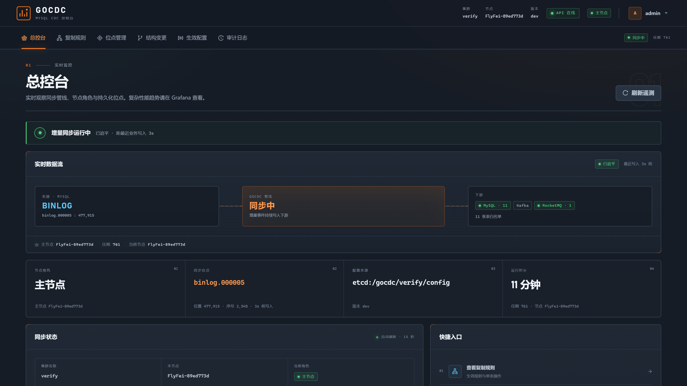
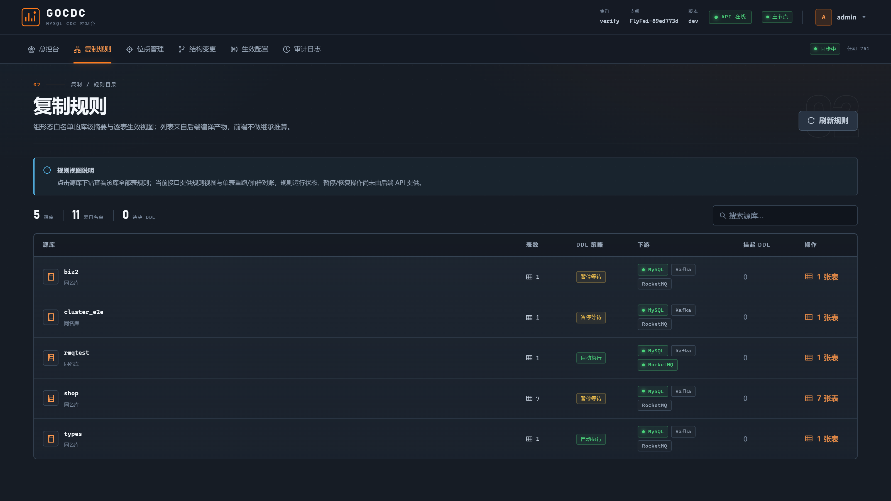
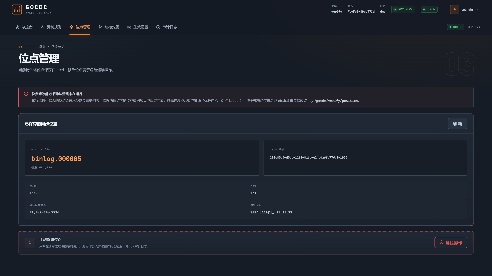
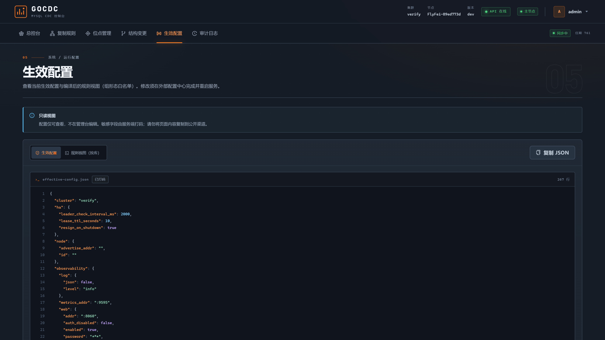
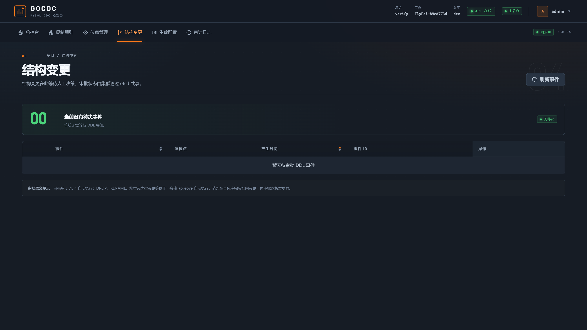

# gocdc-mysql

<p align="center">
  <b>单 Go 二进制的 MySQL CDC —— binlog → MySQL / Kafka / RocketMQ，<br>
  内置高可用、DDL 审批、字段脱敏。</b>
</p>

<p align="center">
  <a href="README.md">English</a> | 简体中文
</p>

<p align="center">
  <a href="#license"></a>
  
  
  <!-- TODO: GitHub Actions CI 与 Release 就绪后取消注释
  <a href="https://github.com/qingflyfei/gocdc-mysql/actions/workflows/ci.yml"></a>
  
  -->
</p>

<p align="center"></p>

---

## 为什么做 gocdc？

现有 MySQL CDC 工具要么是 JVM 全家桶（canal、Debezium、Flink CDC），要么是
没有真 HA、不管 DDL、不带脱敏的单机 Go 工具。gocdc 补的是中间这块：

- **单 Go 二进制，零 JVM** —— Web 控制台 `go:embed` 内嵌，部署是一个进程，
  不是一个平台。
- **内置高可用** —— etcd 选主；leader 被 `kill -9` 后，热备节点在
  lease TTL + 10s 内接管，**窗口期零丢失**（位点在 etcd，MySQL sink 幂等 upsert）。
- **并行管线 + 水位线位点** —— binlog 单点拉取后按 `schema.table` 分片到
  N 个 worker 并行；表内严格有序，位点只越过已完整落盘的事件。
- **全量 + 增量一次打通** —— 一致性快照（FTWRL / `LOCK INSTANCE FOR BACKUP`）
  在快照时捕获 binlog 位点，完成后无缝切增量；表级完成标记存 etcd，重启不重跑。
- **DDL 有审批流** —— `pause`（默认：管线冻结，Web 一键审批）、`auto`
  （白名单：加列 / varchar 扩容 / COMMENT）、`ignore`；破坏性 DDL（DROP/RENAME）
  永远要人工。
- **字段脱敏内置** —— `phone` / `email` / `hash_md5` / `hash_sha256` /
  `truncate` / 固定值 / 置空，全量与增量行为一致。
- **先信任，再验证** —— at-least-once 投递 + 全局唯一 `event_id` 供下游去重，
  另有内置抽样对账接口（`POST /api/v1/verify`）。
- **可观测开箱即用** —— Prometheus `/metrics`、`/healthz`、`/readyz`，
  附 Grafana 面板与告警规则，内嵌 Web 控制台。

## 60 秒上手

前置要求：Docker（带 Compose）。没了。

```bash
git clone --depth 1 https://github.com/qingflyfei/gocdc-mysql.git
cd gocdc-mysql/deploy
docker compose up -d          # etcd + MySQL(源) + MySQL(目标) + gocdc
docker compose ps             # 等全部 healthy
```

**1. 往源库写一行**

```bash
docker compose exec mysql-src mysql -uroot -p123456 -e \
  "INSERT INTO demo.orders (user_id, amount, remark, phone) VALUES (1, 9.90, 'hello', '13800001234');"
```

**2. 目标库出现这行数据**

```bash
docker compose exec mysql-dst mysql -uroot -p123456 -e "SELECT * FROM demo.orders\G"
```

**3. 看指标**

```bash
curl -s http://127.0.0.1:9595/metrics | grep gocdc_
```

**4. HA 演示 —— 杀掉 leader，看自动接管**

```bash
docker compose --profile cluster up -d            # 第二个节点以热备身份加入
curl -s http://127.0.0.1:9595/metrics | grep gocdc_leader_state   # leader=1
curl -s http://127.0.0.1:9596/metrics | grep gocdc_leader_state   # leader=0

docker compose stop gocdc-1                       # 杀掉 leader
# gocdc-2 约 lease TTL（10s）+ 10s 内接管，从 etcd 位点续传——
# 接管窗口期写入的数据不丢。
```

> Web 控制台监听容器内 `:8060`（演示凭据 HTTP Basic `admin` / `demo123`）。
> 想看 UI 需在 `deploy/docker-compose.yml` 里映射该端口。本演示是 MySQL→MySQL；
> Kafka / RocketMQ 下游在配置文件 `targets:` 段启用（见[使用指导](docs/GUIDE.md)）。

## 界面预览

| | |
|---|---|
| **复制规则** — 规则级下游与 DDL 策略 | **位点管理** — etcd 位点 + 危险操作门禁 |
|  |  |
| **生效配置** — 敏感字段服务端打码 | **结构变更审批** — 人工决策前管线冻结 |
|  |  |

## 适用场景

| 场景 | gocdc 怎么接 |
|------|--------------|
| **缓存 / 搜索索引同步** | 行变更发 Kafka（`key=主键` → 同键有序）；消费端重建 Redis 缓存或搜索索引，`event_id` 让 at-least-once 去重变得 trivial。 |
| **MySQL → MySQL 复制与聚合** | 多个源库聚进一个目标库——同名表、幂等 upsert、DDL 自动同步或审批，唯一索引预检。 |
| **准零停机迁移** | 一致性快照 + binlog 追平一次打通；`/api/v1/verify` 抽样对账到 mismatch=0 再切流。 |
| **脱敏供数** | `mask_columns`（phone/email/hash/truncate）对快照与 binlog 生效一致——给测试/预发环境供脱敏副本。 |
| **服务间变更事件总线** | envelope JSON 含 `before`/`after` 全像、位点、GTID、`event_id`；下游按主键有序地响应 INSERT/UPDATE/DELETE。 |

## 与同类工具对比

| | **gocdc** | canal | Debezium | go-mysql-transfer |
|---|---|---|---|---|
| 语言 / 运行时 | Go 单二进制 | Java（JVM） | Java（Kafka Connect） | Go 单二进制 |
| HA 与故障接管 | etcd 选主，自动接管 ≤ TTL+10s，零丢失 | 基于 ZooKeeper | Kafka Connect 分布式 | ZK/etcd，选举存在已知缺陷 |
| MySQL → MySQL 直写 | ✅ 幂等 upsert | 需另装 adapter | 需 sink connector | ✅ |
| Kafka / RocketMQ | ✅ 双支持，按主键有序 | ✅ | 原生 Kafka | ✅ |
| DDL 处理 | 审批流 / 白名单自动 | 通知，下游人工 | schema history topic | 人工 / 能力有限 |
| 内置字段脱敏 | ✅ 快照+增量一致 | ✗ | SMT（基础） | ✗ |
| 管线 | 并行分片 + 水位线 | 单实例单管线 | connector task | 单线程 |
| 对账校验 | ✅ 内置 API | ✗ | ✗ | ✗ |
| Web 控制台 | ✅ 内嵌 | 独立 admin 应用 | 外部 UI | 基础 |
| 状态 | 活跃开发中 | 成熟 | 成熟 | 基本停更 |

需要流式 SQL 变换或超大规模 exactly-once？那是 Flink CDC 的领域——一个完整的
流计算集群。gocdc 定位在轻量单二进制这一端。

## 投递语义承诺

- **At-least-once，绝不做 at-most-once**：位点只越过已完整落盘的事件（水位线），
  崩溃后重放而不是跳过。
- **表内严格有序**；MQ 按主键分片保序——Kafka 用 `key`，RocketMQ 用 FIFO
  message group。
- **MySQL sink 幂等** —— upsert 语义消化重放；消费端按全局唯一 `event_id` 去重。
- **接管零丢失** —— 位点与快照标记都在 etcd；新 leader 从最后检查点续传并重放
  一小段窗口。
- **DDL 冻结语义** —— 未审批的 DDL 让管线暂停（位点冻结），而不是带着 schema
  缺口继续跑。宁可停，不带缺口。

## 架构

```
              选主 · 位点 · 配置 · DDL 审批门禁
                    ┌──────  etcd  ──────┐
                    │   （生产 3 节点）   │
                    └─────────▲──────────┘
                              │
 MySQL ──ROW binlog──► gocdc ─┴───┬──► MySQL       幂等 upsert 直写
 (ROW + FULL 行镜像)  leader +     ├──► Kafka       每表一个 topic，key=主键
                      热备节点     └──► RocketMQ v5  FIFO，message group=主键

                      Web 控制台 · /metrics · /healthz · /readyz
```

## 文档

| 文档 | 内容 |
|------|------|
| [docs/GUIDE.md](docs/GUIDE.md) | 完整使用指导：源/目标库要求、全字段配置、部署形态、DDL 处理、MQ topic、go-mysql-transfer 迁移、生产 checklist、FAQ |
| [docs/RUNBOOK.md](docs/RUNBOOK.md) | 运维手册：位点回拨、重跑全量、故障演练、etcd 故障、DDL 审批 |
| [docs/arch/](docs/arch/README.md) | 11 篇设计文档：管线并行、投递语义、快照协议、DDL 策略、背压、可观测性 |
| [deploy/README.md](deploy/README.md) | 演示拓扑与验证命令 |
| [docs/TESTCASES.md](docs/TESTCASES.md) | 验收测试清单 |

> RocketMQ 用户注意：topic 必须**预建并带 FIFO 属性**（v5 gRPC 客户端不自动建
> topic）——见 [GUIDE §7.2](docs/GUIDE.md)。

## Roadmap

待定——暂无排期。现有决策：gocdc 把变更事件投递到 Kafka / RocketMQ、
并幂等写入 MySQL，投递边界到此为止；缓存、搜索索引等其余下游场景交给
这些 topic 的消费方解决，因此暂不新增 sink。

## 项目状态

核心管线已完成，覆盖集成测试（testcontainers：MySQL 8.4、etcd 3.5、
Kafka）与端到端 HA 演练。目前是 v0.x：v1.0 前 API 与配置 schema 仍可能调整。

## 参与贡献

欢迎 Issue 与 PR。代码改动提交前请跑 `make test` 与 `make test-race`；
集成测试另需 Docker。

## 交流沟通

| 微信交流|
|----------|
|   |

如果这个项目帮你省掉了一次深夜救火，请作者喝杯咖啡 ☕

## License

[Apache-2.0](LICENSE)
