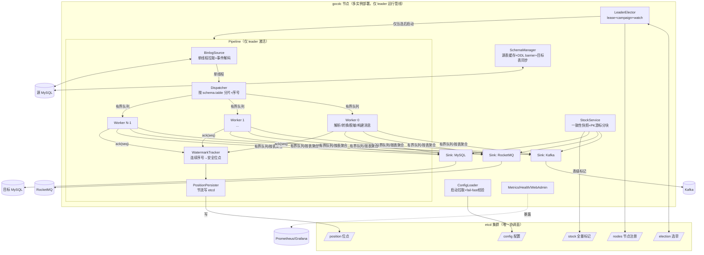

# 02 · 目标架构总览

## 1. 设计原则

1. **正确性优先**：位点永不超前于已投递数据；任何故障路径不产生静默丢失——要么投递成功，要么位点回退重放（at-least-once）。
2. **有界资源**：全链路无无界缓冲；队列满即反压到 binlog 拉取，宁可延迟不可 OOM。
3. **etcd 为唯一协调面**：配置、位点、选举、节点注册全部走 etcd（单客户端、v3.5、TLS/auth 支持）；进程无本地状态文件。
4. **明确语义承诺**：MySQL sink 幂等最终一致；MQ at-least-once 可重复，消息自带 `event_id` 供去重。
5. **简单可运维**：单二进制（前端 go:embed）、fail-fast 启动校验、 Grafana 看图 + Web 只做操作。

## 2. 总体架构



## 3. 模块划分与代码结构

```
gocdc-mysql/
├── cmd/gocdc/main.go              # 入口：flag、信号、装配、优雅停机
├── internal/
│   ├── config/                    # 配置模型、etcd/文件加载、严格校验
│   ├── etcdx/                     # etcd 客户端封装：KV(带重试)、选举、节点注册、TLS/auth
│   ├── source/                    # binlog 拉取：go-mysql-org/go-mysql BinlogSyncer 封装、
│   │                              #   IncludeTableRegex 过滤、断线重连监督、GTID 可选
│   ├── pipeline/                  # Dispatcher（分片+序号）、Worker、Watermark、Barrier
│   ├── schema/                    # 源表结构缓存、information_schema 加载、DDL 识别
│   ├── transform/                 # 值类型转换、脱敏、消息/行数据构建
│   ├── sink/
│   │   ├── sink.go                # Sink 接口 + 双写 SinkGroup
│   │   ├── mysql/                 # upsert/delete 生成、批量事务、目标表结构同步
│   │   ├── kafka/                 # franz-go 幂等生产者、key/分区策略
│   │   └── rocketmq/              # v5 gRPC 顺序消息（message group）、tag、错误处理
│   ├── stock/                     # 快照锁、PK 游标分块扫描、交接协议、表级断点
│   ├── position/                  # 位点模型（file+pos+gtid）、etcd 持久化、节流
│   ├── metrics/                   # Prometheus 指标注册与上报
│   ├── api/                       # admin REST API（gin + auth + 审计；前端产物 embed 挂载）
│   └── logging/                   # zap 封装、敏感列脱敏日志
├── web/                           # 前端源码（React18+AntD5，构建产物 embed 进 internal/api）
├── deploy/                        # Dockerfile、k8s manifests、grafana dashboard/alerts json
├── docs/arch/                     # 本文档集
└── go.mod
```

## 4. 核心数据流

### 4.1 增量（正常路径）

1. `BinlogSource`（单 goroutine）从 etcd 位点启动 `BinlogSyncer`（file+pos，可选 GTID），逐事件解码；`IncludeTableRegex` 在库层过滤无规则表。
2. `Dispatcher` 为每个行事件分配**单调递增全局序号 seq**，按 `hash(schema.table) % N` 路由到对应 worker 的**有界队列**（容量默认 8192 事件）；队列满 → 阻塞 Dispatcher → 阻塞 binlog 拉取（TCP 反压到源库 dump 线程）。
3. `Worker`（N 个，默认 4~8）从队列取出事件：值转换（04 §7 规格）→ 脱敏/过滤（10 文档）→ 构建 sink 载荷 → **同表内严格按 seq 顺序**写入 SinkGroup：
   - MQ sink：攒批（条数/时间）后发送，Kafka key=`{db}.{table}.{pk}`、RocketMQ 顺序消息组键同 key 语义（点→下划线，字符集与 topic 同）；topic 命名两下游统一 `prefix + {db}_{table}`（05 §2.3）；
   - MySQL sink：按表聚合生成多行 upsert / IN 删除，分块事务提交。
4. 每个 worker 处理完某事件后向 `WatermarkTracker` ack(seq)；tracker 维护**连续已确认序号**的滑动窗口，得到全局安全水位 W（所有 seq ≤ W 的事件已全部投递成功）。
5. `PositionPersister` 把 seq=W 对应事件的 binlog 位点持久化到 etcd（XID 触发、3s 节流、rotate/DDL/停机强制）。**位点=W 的语义：W 之前的所有事件已投递到全部已启用的 sink。**

### 4.2 全量（首启/手动触发）

见 06 文档：一致性快照锁 → 记录位点 P → PK 游标分块扫描 → 走同一 transform/sink 链路写入（消息带 `"phase":"snapshot"`）→ 表级完成标记写 etcd → 释放锁 → 增量从 P 启动重放收敛。

### 4.3 DDL（barrier）

见 08 文档：DDL 事件作为该表 worker 的 barrier —— 排空该表在途事件 → 按 `ddl_policy` 同步目标表/暂停 → 原子刷新该表 schema 缓存 → emit DDL 消息到 MQ（可配）→ 继续。全局由 Dispatcher 协调跨 worker 屏障。

## 5. 线程模型与顺序性

| goroutine 类别 | 数量 | 职责 |
|---|---|---|
| binlog 拉取/解码 | 1 | Syncer 内部，事件解码后交给 Dispatcher 回调 |
| Dispatcher | 1 | 分配 seq、路由分片、DDL 全局 barrier |
| Worker | N（默认 min(8, CPU)） | 解析、转换、脱敏、攒批发送、ack |
| Watermark/Persister | 1 | 水位推进、etcd 节流落盘 |
| watchdog/监督 | 1 | sink 健康、canal 重启、leadership 复核 |
| Stock worker | M（配置） | 仅全量阶段存在 |

**顺序性承诺（写入文档与监控口径）**：

- **同一行（同 PK）严格有序**：表内有序 + MQ 按行 key 分区有序 + MySQL 同表串行 upsert。
- **同一表事件严格有序**：表 → worker 亲和（哈希）保证。
- **跨表不保证全局时序**，只保证最终收敛：MySQL sink 各表独立 upsert，最终状态与源一致；多表事务会被拆分到不同时刻到达（与 MQ 下游语义一致）。**注意**：目标库不应依赖跨表外键级联约束（文档明示，DDL 策略默认禁止在目标库建外键）。
- **事务原子性不跨表保留**：单表内一个 binlog 事务的多行仍在一个批处理单元内有序。

## 6. 关键技术选型

| 领域 | 选型 | 理由 |
|------|------|------|
| Go | **1.24.x（toolchain 锁定 `go 1.24`，用户指定）** | 不追最新大版本；go.mod 显式 toolchain 指令 |
| binlog | `github.com/go-mysql-org/go-mysql` **≥ v1.7 最新 patch**（在 go.mod 锁定并记录） | siddontang 库的维护版：MySQL 8 认证（caching_sha2_password）、GTID、bug 修复；仅用 `replication`（BinlogSyncer）+ `schema`（表结构缓存）；Dispatcher/Watermark/位点管理由本项目自建（04 文档） |
| etcd | `go.etcd.io/etcd/client/v3` **v3.6.x（实施期锁 v3.6.8）**，唯一 import 路径 | **版本策略：不用最新 minor（当前最新 v3.7.x），取其后 1~2 个 minor 的最新 patch**——v3.6 仍在活跃维护、生态验证充分，且 client/v3 与 v3.5+ 服务端线路兼容；并发选举用 `clientv3/concurrency` |
| MySQL driver | `go-sql-driver/mysql` 最新 | 稳定 |
| Kafka | `twmb/franz-go` | 生产端默认幂等、同步确认不漏错；团队生产在用；兼容 Go 1.24 |
| RocketMQ | `apache/rocketmq-clients/golang/v5`（gRPC） | 官方当前主线；顺序消息走 message group；v2 线已入维护模式 |
| Web 框架 | gin 最新 | 团队熟悉，仅做 admin API |
| JSON | `encoding/json`（热点路径可选 sonic/jsoniter 基准后定） | 消息构建是大头，先以标准库正确实现，压测后决定 |
| 日志 | zap（stdout，无文件轮转） | 容器由 logging driver 收集 |
| 指标 | prometheus/client_golang 最新 | 事实标准 |
| 前端 | React 18 + TypeScript + Vite + Ant Design 5 | 国内管理台事实标准、表格/表单组件最全；构建产物 dist/ 由 go:embed 内嵌（与 Vue 无部署差异，见 13 文档） |

**明确不引入**：Redis/MongoDB/ES/RabbitMQ 客户端、Lua 引擎（依赖最小化的范围决策；缓存、搜索等其余下游场景由 MQ topic 的消费方解决，不再规划额外 sink）。

## 7. 需求 → 机制映射

| 需求 | 机制 | 承载模块 |
|------|------|---------|
| 1 etcd 单点 | lease 选主 + watch + leadership 复核 watchdog | etcdx、pipeline 装配 |
| 2 并行 binlog | 表级哈希分片 + N worker + watermark | pipeline |
| 3 etcd 配置 | 单 key（YAML 正文，唯一格式）、启动拉取、fail-fast、重启生效 | config |
| 4 etcd 位点（key 可配） | `position_key` 配置项 + 节流持久化 | position |
| 5 MQ+MySQL 双写 | SinkGroup 按规则路由；MySQL 同表约束；MQ 完整事件 JSON | sink、transform |
| 6 全量交接 | 快照锁 + 位点 P + 完成后重放 + etcd 表级标记 | stock |
| 7 幂等/语义 | at-least-once + upsert/IN 删除幂等 + event_id | sink、pipeline |
| 8 DDL | ddl_policy + barrier + 白名单同步 + schema 缓存原子刷新 | schema、pipeline |
| 9 背压 | 全链路有界队列 + sink 超时熔断 + 内存预算 | pipeline、sink |
| 10 脱敏 | exclude_columns / mask_columns，全量增量统一 | transform |
| 11 可观测 | 指标体系 + /metrics + Grafana + 告警 | metrics、web |
