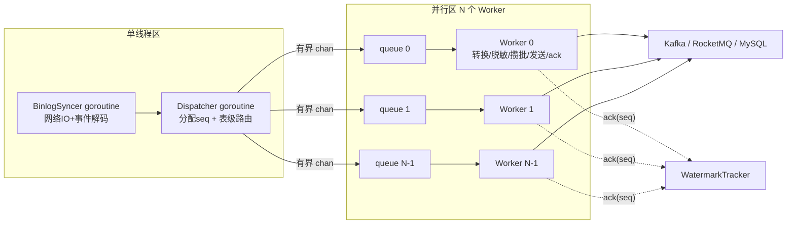

# 04 · binlog 管线与并行化设计

> binlog 拉取保持单线程，解析、转换与下游写入按库+表并行——用表级分片 + 水位线位点，把吞吐做上去的同时保住表内严格有序。

## 1. 目标线程模型



职责边界：

- **BinlogSyncer（1 goroutine）**：`go-mysql-org/go-mysql` 的 `replication.BinlogSyncer`。仅做：协议握手、事件流读取、binlog 事件解码（含 RowsEvent 的行数据原始解析）。不使用 canal（其单消费者 handler 模型、位点、重试逻辑全部自建）。
- **Dispatcher（1 goroutine）**：
  1. 为每个「行事件单元」分配单调递增 `seq`（uint64）；
  2. `shard = fnv32(schema + "." + table) % N` 路由到 worker 队列；
  3. 处理控制事件：Rotate（广播位点标记到所有 worker，作为同步屏障）、DDL（该表 barrier，见 08）、XID（交给水位线跟踪，用于把 seq 映射回 binlog 位点）。
- **Worker（N 个）**：从有界队列取出事件 → 值转换 → 脱敏/过滤 → 构建 sink 载荷 → 攒批发送（SinkGroup）→ 成功后 `ack(seq)`。
- **WatermarkTracker（1 goroutine）**：见 §5。
- **事件单元粒度**：一个 RowsEvent 的**一行**——并行度更均匀；UPDATE 一行 = before+after 合并为一个单元。

## 2. 分片策略

- **按表分片**（`hash(schema.table) % workers`），不按行/PK 分片：
  - 表内事件全序天然保持（单队列 FIFO），满足「同一行/同一表严格有序」；
  - 行级分片会给 UPDATE 前后像、DDL barrier、MySQL 同表批量聚合带来跨 worker 乱序难题，收益不成比例；
  - 热表倾斜时，单表并行度受限——这是**明示的取舍**：同一行的顺序价值高于单表吞吐。若未来单表成为瓶颈，升级路径是表内按 PK 哈希二次分片 + 行序由 MQ key/MYSQL upsert 收敛（预研项，不在本期）。
- 分片函数可配置（默认 fnv1a-32）；worker 数变更需重启（配置不热更，天然一致）。

## 3. 控制事件处理

| 事件 | Dispatcher 行为 |
|------|----------------|
| RotateEvent | 构造 `PosMark(seq, newFile, 4)` 广播进**所有** worker 队列；各 worker 处理到该标记后 ack，水位线跨越后 Persister 才可记录跨文件位点（防止位点文件名与数据内容错位） |
| QueryEvent(DDL) | 进入 DDL barrier 流程（08 文档）：排空该表 → 执行策略 → 刷新 schema → 该表后续事件用新 schema 转换 |
| XIDEvent | 记录 `seq → {file, pos}` 映射（滑动窗口内），供水位线把 seq 翻译成位点 |
| GTIDEvent | use_gtid=true 时同上记录 gtid |
| 心跳/空转 | 触发「无事件也允许保存位点」检查（长时间无写入时位点仍可推进到 master 当前位置，减少重放窗口） |

## 4. 队列与内存

- 每 worker 一个 `chan *EventUnit`，容量 `worker_queue_size`（默认 8192）。
- **满即阻塞 Dispatcher** → Syncer 的 TCP 读停 → 源库 dump 线程阻塞（binlog 服务器端发送缓冲积压）→ 天然反压，绝不丢事件。sink/endpoint 持续失效时 worker 停止 ack、队列自然填满、整体反压——**没有「清空缓冲丢弃」路径**（失败处理见 05 §7）。
- 内存上界估算：`workers × queue_size × 平均行大小 + 批量缓冲`，默认配置在 1KB/行时 ≈ 8 workers × 8192 × 1KB × (队列+批量≈1.5) ≈ **100MB 级**，配合 `GOMEMLIMIT`（09 文档）。
- EventUnit 池化（`sync.Pool`）。

## 5. 水位线（Watermark）位点推进算法

问题：并行 worker 完成时间不一，位点只能取「全部 sink 已确认」的连续水位。

```go
// 伪代码
type Watermark struct {
    mu       sync.Mutex
    base     uint64            // 已确认的连续水位
    pending  map[uint64]bool   // 已 ack 但不连续的 seq（稀疏集合）
    seqPos   map[uint64]Pos    // Dispatcher 写入的 seq→位点（窗口内有效）
}
func (w *Watermark) Ack(seq uint64) {
    lock; pending[seq]=true
    for pending[base+1] { base++; delete(pending, base) }   // 推进连续水位
    if advanced { w.lastPos = seqPos[base]; trim seqPos(< base) }
}
```

- `base` 即全局安全水位 W：**所有 seq ≤ W 的事件已被全部启用的 sink 投递成功**。
- PositionPersister 周期（3s 节流）把 `seqPos[W]` 写 etcd；rotate/DDL/停机强制。
- Worker 崩溃/卡死：该 worker 未 ack 的 seq 成为洞，水位停住 → 反压拉取 → watchdog 检测 worker 存活（心跳/超时），必要时重建管线（从 etcd 位点重放）。
- **位点不变式（核心承诺）**：`etcd 位点 ≤ 任何 sink 实际收到的最后事件位点`，即位点永不超前，重放只会重复不会丢失。

## 6. 设计要点速览

| 维度 | 设计 |
|------|------|
| 解析/发送 | 拉取单线程 + N worker 并行 |
| 事件单元 | 行级（RowsEvent 拆到行，并行度均匀） |
| 缓冲 | 有界队列，满则反压（无丢弃路径） |
| 位点 | watermark 连续确认后节流持久化 |
| 失败恢复 | sink 级重试/熔断，管线级 watchdog |
| DDL | barrier 协议 |
| GTID | 可选支持（位点含 gtid_set） |

## 7. 值类型转换规格（transform 层权威定义）

> 所有转换显式、可测；「失败」不允许静默变 NULL/0，而是：可配置 `on_convert_error: null | zero | fail_event`（默认 null + 计数告警）。

| MySQL 类型 | 转换为 | 说明 |
|-----------|--------|------|
| TINYINT/…/INT (signed) | int64 | — |
| 整型 (unsigned) | uint64；> MaxInt64 时 MQ 输出 JSON number、MySQL sink 绑 uint64 | 不经 int64，避免回绕 |
| BIGINT UNSIGNED 超过 uint64 | decimal 字符串 | 罕见，兜底 |
| DECIMAL/NUMERIC | **string（默认，无损）**；可配 `decimal_as: string\|float` | 无损；MQ 默认输出字符串+列元信息让消费方知道标度 |
| FLOAT/DOUBLE | float64 | 本身有精度语义 |
| DATETIME | 格式化字符串（源时区 `source.timezone` 显式解释）| 零日期 `0000-00-00 00:00:00` → 按配置：null 或原样字符串（默认 null+计数） |
| TIMESTAMP | UTC 时间戳→按 `source.timezone` 格式化 | — |
| DATE | "2006-01-02" | — |
| TIME | "15:04:05"（binlog 原始 duration 还原） | — |
| YEAR | int | — |
| BIT(n) | **uint64（按位解码）** | 位模式精确还原 |
| ENUM | 字符串（索引查表；越界 → fail_event + 告警） | 越界不静默降级 |
| SET | 逗号拼接字符串（位掩码解码） | — |
| JSON | **raw string（不反序列化）**：MQ 输出为嵌套 JSON 值（json.RawMessage）；MySQL sink 直接绑 []byte | 不反序列化，无损 |
| BLOB/TEXT/BINARY | []byte：MySQL sink 绑 []byte；MQ 输出 UTF-8 尝试解码失败则 base64 + `"encoding":"base64"` 标记 | — |
| 字符类型 | 按 charset 解码为 string（utf8mb4） | — |

补充规则：

- 转换输入统一取自 binlog 行数据（增量）或文本协议行（全量），**全量路径复用同一转换器**，增量/全量无转换语义漂移。
- 每次转换附带列元数据（名/类型/索引），供脱敏与消息构建。
- 转换耗时与错误计数暴露为指标（11 文档）。

## 8. 优雅停机与重放协议

```text
SIGTERM:
 1. 停止接收新事件（Syncer 停止/暂停 dump）
 2. Dispatcher 广播 DrainMark → 各 worker 排空队列、flush 未发送批
 3. SinkGroup.Close()（等待在途确认，超时 sink_timeout_shutdown 默认 30s）
 4. Watermark 终值 → PositionPersister 强制保存
 5. Resign leadership（ha.resign_on_shutdown）
 6. 关闭 etcd/web/metrics
```

超时兜底：任一步超时 → 记录日志后进入下一步（位点可能落后 → 重启重放，at-least-once 兜底，正确性不受影响）。

kill -9：位点最多落后 3s + 队列在途数据 → 重启从位点重放，重复由幂等消化。
