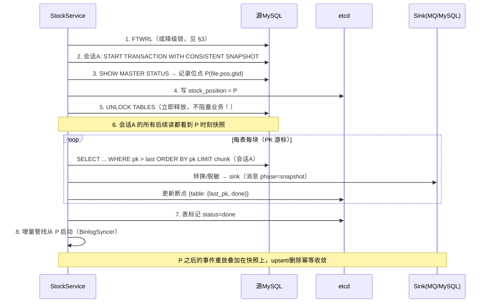

# 06 · 全量初始化与增量一致性交接

> 解决全量初始化与增量衔接的**窗口丢失/重复**问题：快照内容与增量起点严格对齐，过程幂等、可中断、可续跑，重启不重跑。

## 1. 目标语义

对每张启用 `do_stock` 的表，保证：**全量快照内容与增量起点严格对齐，不重不漏地收敛到源库终态**，且过程幂等可中断可续跑。

核心不变式：

> 快照读取的每个字节都来自 binlog 位点 P 时刻的一致性视图；增量从 P 开始重放；下游幂等 → 最终状态 = 源库状态。

## 2. 协议：一致性快照 + 记录位点 P（mydumper/Debezium 式）



关键点：

1. **锁只持有几毫秒**（步骤 1~5），只为拿到「快照 ↔ 位点」的对齐关系，全量扫描期间不锁表——在「完全无锁（位点错位）」与「全程 FTWRL（不可用）」之间取正确折中。
2. **位点 P 先于全量扫描持久化**（步骤 4）：即使全量中途崩溃，增量起点 P 也不会漂移。
3. **增量在快照完成后才启动**（步骤 8）。备选「增量并行+缓冲」方案（省重放时间但内存/复杂度高）明确不做——重放时长 = 全量时长，MySQL sink upsert、MQ 顺序消费都天然消化，正确性简单可证。

## 3. 锁的降级矩阵

| 条件 | 方案 | 快照一致性 |
|------|------|-----------|
| 有 RELOAD 或 FLUSH_TABLES 权限 | `FLUSH TABLES WITH READ LOCK` | 精确 |
| MySQL 8.0 且有 BACKUP_ADMIN | `LOCK INSTANCE FOR BACKUP`（不阻塞 DML）+ 会话A RR 快照 + SHOW MASTER STATUS | 精确（8.0 推荐） |
| 都没有 | 启动配置 `stock.lock_mode: none` 显式声明：记录位点与建快照非原子，**可能窗口丢失**，显式选择 + 如实告警 | 近似 |

启动时按权限自动探测并日志声明所选模式；`none` 模式必须显式配置才允许（防止无感降级）。

## 4. 分块扫描（替代 OFFSET 深分页）

- **PK 游标，不用 OFFSET**：`WHERE pk > :last ORDER BY pk ASC LIMIT :chunk`（chunk 默认 5000）。无自增主键仍可用（比较语义），每块代价恒定。
- 联合主键：行值构造器 `(pk1,pk2) > (:a,:b)`。
- **每表独立进度标记**（etcd `stock/{db}.{table}` = `{status, session_id, snapshot_position, last_pk, chunk_seq, rows_done}`），worker 按表并行（表间并行，表内串行），进度互不干扰。
- **快照会话（session）约束——正确性关键**：`last_pk` 断点只在**同一快照会话**内有效。快照会话 = 那个持有 `CONSISTENT SNAPSHOT` 的连接；会话消失（进程重启/leader 切换/连接断开）后，任何新连接读到的是**当前数据**而非快照@P——若沿用 last_pk 续扫，会出现「后扫的块含较新数据、却被 P 之后的旧增量重放覆盖」的**错序污染**。因此：**标记中的 `session_id` 与当前会话不匹配 → 该表断点作废、整表重扫**（新快照对，见 §4.1）。
- 复用增量管线的同一 transform/脱敏/sink 代码路径，消息 `phase:"snapshot"`、`event_id = "{db}.{table}.snap.{P}.{chunk_seq}.{row_idx}"`——**P 进入 event_id**：同一轮快照内重投幂等（id 相同），跨轮重扫 id 不同（防止 MQ 消费端按 id 去重时丢弃新一轮快照内容）。
- 失败：可重试错误退避重试；不可重试错误 → **该表标记 failed + 告警**，绝不静默丢块。
- 中断续跑（两种情况严格区分）：
  - **会话内存活中断**（chunk 失败重试、瞬时错误）：按 `last_pk` 断点续扫（同一快照会话，安全）；
  - **跨进程/跨主恢复**（重启、leader 切换）：session_id 不匹配 → 该表**从头重扫**，且必须先建**新快照对**（流程见 §4.1）；Web `POST /api/v1/rules/by-schema/{db}/{table}/restock?confirm=true` 可强制重跑。

#### 4.1 恢复协议（含 leader 切换）

```text
启动/接管时对每个 status ∈ {running, failed} 的表:
  1. 若标记 session_id == 本会话且快照连接仍存活 → last_pk 续扫（罕见，仅进程内重试）
  2. 否则:
     a. 短锁（§3 矩阵）→ 新 CONSISTENT SNAPSHOT → 新位点 P2 = max(已记录 P, SHOW MASTER STATUS)
     b. 更新标记 {session_id=新, snapshot_position=P2, last_pk=复位}
     c. 整表重扫（走相同 transform/sink，幂等覆盖旧轮次数据）
     d. 持久化: 全局 stock_position = P2（取所有快照对的**最大值**）
增量启动位点 = 全局 stock_position（= max(P1..Pn)）:
  - 在更早快照对下完成(done)的表，P_i..P2 之间的事件重放属于重复 upsert，幂等收敛
  - 不变量：任何表的快照读取时点 ≤ 增量启动位点 → 每张表都被「完整快照 + 其后全部增量」覆盖
```

## 5. do_stock 语义

- `do_stock: true` 含义改为「**此表允许参与全量初始化**」——是否真正执行由 etcd 完成标记决定：
  - 标记不存在 / status=failed → 启动时执行全量；
  - status=done → 跳过（**重启不再重跑**）。
- 运维动作：Web 触发 `restock`（清标记 → 暂停该表增量 → 重跑全量 → 恢复）。
- 规则级覆盖：大表可单独配置 `stock.chunk_rows` / `stock.throttle_ms`（默认继承全局）。
- 新增表加入规则 → 自动检测无标记 → 首启自动全量 → 完成后增量接管。

## 6. 与新架构的融合点

| 融合点 | 设计 |
|--------|------|
| 管线复用 | 全量块走 Worker 同款 transform→SinkGroup（本模块只产出 EventUnit，不另建写入路径） |
| 交接时序 | StockService 完成 → 通知 Pipeline 以全局 stock_position（= max 所有快照对）启动（位点已存 etcd）；leader 切换发生在全量中途：新 leader 按 §4.1 恢复协议处理——未完成表**整表重扫**（新快照对），已完成表不动；两 leader 短暂并存时靠「标记写入 lease 门槛（03 §4.2-2）+ upsert 幂等」收敛 |
| 位点推进 | 全量期间增量未启动，位点保持 P；增量启动后正常 watermark 推进 |
| 背压 | 全量块走同样的有界队列与 sink 熔断，不会压垮下游 |
| 可观测 | `stock_rows_total{table}`、`stock_progress_ratio`、`stock_chunk_failures`（11 文档） |

## 7. 边界条件

| 场景 | 处理 |
|------|------|
| 全量耗时 > binlog 保留期，P 之前的 binlog 被清理 | 增量启动时检测 `SHOW BINARY LOGS`/`PURGED`，P 已被清理 → **拒绝启动增量**（报错指明需 restock），绝不带着缺口静默运行 |
| 源库是只读副本 | 正常（位点取自该副本的 master status；文档提示应使用同一复制拓扑的副本以减小延迟） |
| 表在全量期间被 DDL | 快照会话 RR 视图不受影响；块间检测 schema 版本变化 → 该表 restock（表级重跑，代价可控） |
| 空表 | 标记 done，0 行 |
| 大单行（长 BLOB） | chunk 按行数截断不受影响；单行超 `max_allowed_packet` 报错指明 |
| 多规则同库大量表 | 表级并行度配置 `stock.workers`（默认 4），对源库压力与 `--maxprocs` 解耦 |
