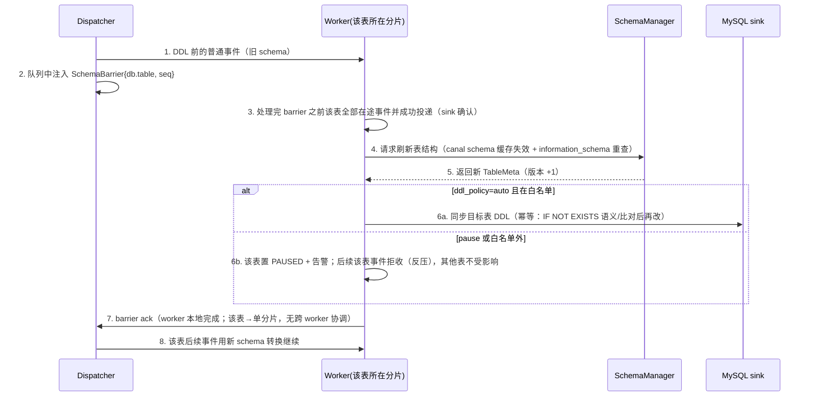

# 08 · Schema 变化（DDL）处理策略

> 解决源表 DDL 引发的 schema 漂移：**DDL 永不静默丢数据**——要么正确同步到目标，要么明确暂停管线等人工决策（宁可停，不带缺口）。

## 1. 设计目标

1. DDL **永不导致静默丢数据**：要么正确处理，要么明确暂停 + 告警。
2. 处理 DDL 时保证新旧 schema 切换的**原子性与有序性**（barrier）。
3. 常见安全 DDL（加列、扩容）自动化，危险 DDL 人工化。

## 2. 策略模型：`ddl_policy`（每规则可配）

| 值 | 行为 | 适用 |
|----|------|------|
| `auto`（默认） | 白名单 DDL 自动同步目标表 + 刷新缓存继续；白名单外 → 自动转 `pause` | 生产默认 |
| `pause` | 任何 DDL → 该表管线暂停 + 告警，人工处理后 resume | 强管控表 |
| `ignore` | 跳过 DDL 继续跑（列数不匹配的行按 `on_convert_error` 处理并计数告警） | 明知目标结构另有管理人；需显式配置 |

白名单（`auto` 下自动执行，且要求 `targets.mysql.ddl_sync: true`）：

| DDL | 目标端动作 | 备注 |
|-----|-----------|------|
| ADD COLUMN | `ALTER TABLE ... ADD COLUMN`（列定义由源 information_schema 生成，含注释） | 追加在末尾；目标列序差异用列名对齐消化（见 §4） |
| MODIFY COLUMN 仅 varchar 长度放大 / 注释变更 | `ALTER TABLE ... MODIFY ...` | 缩小、类型变更不在白名单 |
| ADD INDEX / ADD UNIQUE（可选开关，默认关） | 同步建索引 | 关闭时 pause |
| CREATE TABLE（规则白名单表在目标缺失） | 建表（结构含主键/注释，`IF NOT EXISTS` 幂等） | 白名单外表的 CREATE 不产生事件（组形态无新表自动接入） |

白名单外（DROP/RENAME/改主键/类型变更/charset 变更/分区变更…）→ `pause`。

## 3. Barrier 协议（新旧 schema 原子切换）

DDL 必须满足：**该表在 DDL 之前的事件用旧列信息转换，之后的事件用新列信息，两者互不交错**。



要点：

- barrier 以 **seq** 参与水位线：DDL 位点只有在 barrier ack 后才可越过（`OnDDL` 强制保存位点的旧逻辑由 watermark 统一取代，不再有旁路）。
- **barrier 作用域是 worker 本地**：表 → 分片是确定映射（04 §2），一张表的 DDL 只需该表所在 worker 排空**自己队列里该表**的在途事件，不需要跨 worker 协调；需要全 worker 汇齐 ack 的只有 RotateEvent（文件切换广播，04 §3）。
- **列对齐按列名而非位置**：EventUnit 携带列名→值（源端 schema 提供列序），转换层按列名映射，天然容忍目标列序差异与中间加列。
- MySQL 8.0 instant DDL 秒级完成；若目标 DDL 执行超时（`ddl_timeout` 默认 60s）→ pause。
- MQ sink：DDL 消息可选发送（`ddl_notify`，05 §2.2），消费方据此自适应。

## 4. SchemaManager

- 每表维护 `TableMeta{version, columns[], pk[], indexes, comments}`，版本号单调递增，写入事件消息 `schema_version`。
- 结构来源：canal `schema` 包缓存（`go-mysql-org/go-mysql/schema`）+ information_schema（注释、全量索引），带 TTL 的懒刷新 + DDL 主动刷新。
- 并发安全：TableMeta 不可变对象，切换用 `atomic.Pointer` 替换（快照原子可见，读侧无锁）。
- 启动时对每条规则做一次源/目标结构核对：目标表不存在（且 mysql sink 启用）→ 报错（不自动建表，除 CREATE TABLE 白名单场景）；列缺失/类型不兼容 → 报错列出差异。

## 5. 暂停与人工介入流程

```text
告警（gocdc_pipeline_paused{reason="ddl"}=1）
 → Web `GET /api/v1/ddl-events` 查看 SQL → 运维评估：
    A. 安全 → POST /ddl/{id}/approve?confirm=true（执行目标端 DDL → 复验 → resume）
    B. 危险 → 人工先改目标表 → approve（复验一致即 resume；不一致则拒绝）
    C. 决定跳过 → POST /ddl/{id}/skip?confirm=true（该条 DDL 标记 ignore，审计留痕）
```

所有 DDL 事件（含决策）写入 etcd `events/ddl` 与结构化日志，Web 展示（13 文档）。

## 6. 设计要点速览

| 维度 | 设计 |
|------|------|
| OnDDL | barrier + 策略执行，不只存位点 |
| OnTableChanged | SchemaManager 原子刷新 |
| 列对齐 | 按列名，容忍目标列序差异与中间加列 |
| 目标同步 | 白名单自动 + 人工审批流程 |
| 失败模式 | pause + 告警 + 审计，绝不静默丢行 |
