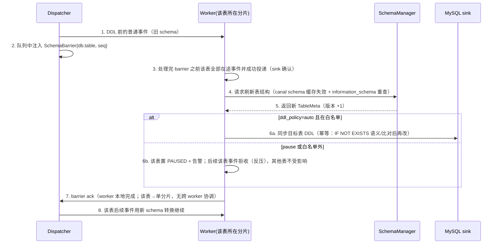

# 08 · Schema 变化（DDL）处理策略

> 解决源表 DDL 引发的 schema 漂移：**DDL 永不静默丢数据**——要么正确同步到目标，要么明确暂停管线等人工决策（宁可停，不带缺口）。

## 1. 设计目标

1. DDL **永不导致静默丢数据**：要么正确处理，要么明确暂停 + 告警。
2. 处理 DDL 时保证新旧 schema 切换的**原子性与有序性**（barrier）。
3. 常见安全 DDL（加列、扩容）自动化，危险 DDL 人工化。

## 2. 策略模型：`ddl_policy`（每规则可配）

| 值 | 行为 | 适用 |
|----|------|------|
| `auto`（默认） | 白名单 DDL 自动同步目标表 + 刷新缓存继续；白名单外 → 自动转 `pause` | 生产默认 |
| `pause` | 任何 DDL → 该表管线暂停 + 告警，人工处理后 resume | 强管控表 |
| `ignore` | 跳过 DDL 继续跑（列数不匹配的行按 `on_convert_error` 处理并计数告警） | 明知目标结构另有管理人；需显式配置 |

白名单（`auto` 下自动执行，且要求 `targets.mysql.ddl_sync: true`）：

| DDL | 目标端动作 | 备注 |
|-----|-----------|------|
| ADD COLUMN | `ALTER TABLE ... ADD COLUMN`（列定义由源 information_schema 生成，含注释） | 追加在末尾；目标列序差异用列名对齐消化（见 §4） |
| MODIFY COLUMN 仅 varchar 长度放大 / 列安全属性（默认值/可空/注释） | `ALTER TABLE ... MODIFY ...` | 缩小、类型变更不在白名单 |
| CREATE TABLE（规则白名单表在目标缺失） | 建表（结构含主键/注释/列序，`IF NOT EXISTS` 幂等）。两条触发路径：① 运行期 DDL 事件 diff；② **启动对账**（2026-11-11）——节点启动时对规则覆盖的缺表直接执行（ddl_sync=true 且策略非 ignore；挂起审批表除外）。必须启动期补建的根因：新表进白名单前其 CREATE 事件已被过滤，运行期永远等不到 | 白名单外表的 CREATE 不产生事件（组形态无新表自动接入）；目标**库**（DATABASE）不自动建，须预建 |

白名单外（DROP COLUMN/RENAME/改主键/类型变更/缩容…）→ `pause`。

**全量对账（2026-11-09 approve 必炸陷阱修复）**：diff 引擎为**全部**差异生成可
执行语句（白名单内外均生成，逐条带分类标记与白名单位）：

- `approve`（人工批准）= 执行**全部**对账语句（含删列/改名/类型变更/缩容/主键
  变更）→ 复验一致 → 自动恢复。旧版非白名单差异无语句可执行，approve 复验必
  失败 fatal，且重启重放命中已决 approve 再次 fatal = 死循环；已废除。
- `auto` = 仍只自动执行白名单子集（语义不变）；源表已删/改名走（ErrSourceTableGone）
  按过期放行（skip + 审计），不再 fatal。
- 列改名按「同 ORDINAL_POSITION + 同 DATA_TYPE」配对推断，生成 `CHANGE COLUMN`
  （数据保留，改名+类型微调一条覆盖）；误配对（实为同位删+加同型）后果 = 旧值
  残留至该行下次 upsert，审计明细逐条列出推断依据。
- 断点续跑命中已决 approve/skip = **只放行不重执行**（重复 ALTER 必报错）；approve
  首次执行失败后人工修复目标库，重启重放即放行，残余差异由后续 DDL diff 自愈。
- 索引/charset/分区等列级以外的差异不参与对账（也不阻塞行同步）。

**收敛循环与值域兼容（2026-11-09 E2E 三连修）**：burst 期间源库实时结构持续演进，
单次 diff→apply 会把目标库留在中间态、行结构缓存（meta）却已刷新到终态——间隙
行按终态列名寻址目标库没有的列 → 1054 熔断。auto/approve 路径均为
**diff→apply→refresh 收敛循环**（≤10 轮，直至 target==live；非白名单残差转
pause/approve 全量执行），保证行事件处理时 meta==target==live 三者一致。同时
转换器补齐类型变更间隙行的值域兼容（raw 按写入时 TABLE_MAP 解码 vs meta 实时
类型）：整型家族（含窄整型 int8/16/32）↔decimal/float/string/bytes、带小数点
文本→int（四舍五入，MySQL 隐式转换语义）。

**已知限制（语句级 schema 演进专项解决）**：DDL 间隔小于管线处理时延（毫秒级
burst）**且**含中间位置列变更（`AFTER`/`FIRST` 加列、或其后的删列/改名重排）
时，间隙行按终态列名位置对齐会错位——字符串落进数值列 → on_convert_error 置
null → NOT NULL 列 1048 熔断（可见暂停，非静默；恢复见 RUNBOOK §5）。追加式
加列/改名/类型变更的 burst 已全场景安全（E2E 27 断言 + 集成回归覆盖）。运维
规避：DDL 逐条间隔执行（>1s）或 burst 内避免 `AFTER`/`FIRST`。

**2026-11-10 二轮 review 补强（E2E 第二套件 32 断言验证）**：
- 主键变更 DROP+ADD 合并为**单条原子 ALTER**（分开执行对 AUTO_INCREMENT 列报
  1075）；自增列退出主键先 MODIFY 去自增，新主键就位后按源端定义恢复。
- **唯一索引参与对账**（签名比对同启动核对口径）：源端 ADD/DROP UNIQUE INDEX
  生成补建/删除语句（白名单外挂起审批）——否则目标永远缺失，下次启动被
  VerifyTargetTable fail-fast 拒启。表达式索引不生成语句（启动核对同样拒绝）。
- `CREATE/DROP INDEX ... ON t(...)` 语句形态纳入 barrier 表定位（此前掉进
  「无法定位」pause → 被当 ErrSourceTableGone 过期放行，索引对账接不到事件）。
- **TRUNCATE 一律挂起**（结构 diff 对数据无感知，静默 ack = 目标数据永久分歧；
  且 TRUNCATE 不产生行事件、自增重置后主键复用——放行/skip 都无法靠 upsert 收敛）：
  **approve = 系统在目标端同步执行 TRUNCATE 镜像**（人工批准=确认镜像源端清空，
  2026-11-10 用户纠偏语义）；skip = 目标保留旧数据副本（源库疑似误清的保守
  选择），差异人工处理。
- 启动核对感知 **pending DDL**：有挂起审批记录的表结构差异降级告警——挂起等
  审批期间节点重启不再被 fail-fast 拒启（管线重放停回同一审批，事件 ID 不变）。
- 值转换兼容补齐：float32/带小数点文本 → int/unsigned int（四舍五入，MySQL
  隐式转换语义；uint64 越界仍走原样字符串兜底）。

## 3. Barrier 协议（新旧 schema 原子切换）

DDL 必须满足：**该表在 DDL 之前的事件用旧列信息转换，之后的事件用新列信息，两者互不交错**。



要点：

- barrier 以 **seq** 参与水位线：DDL 位点只有在 barrier ack 后才可越过（`OnDDL` 强制保存位点的旧逻辑由 watermark 统一取代，不再有旁路）。
- **barrier 作用域是 worker 本地**：表 → 分片是确定映射（04 §2），一张表的 DDL 只需该表所在 worker 排空**自己队列里该表**的在途事件，不需要跨 worker 协调；需要全 worker 汇齐 ack 的只有 RotateEvent（文件切换广播，04 §3）。
- **列对齐按列名而非位置**：EventUnit 携带列名→值（源端 schema 提供列序），转换层按列名映射，天然容忍目标列序差异与中间加列。
- MySQL 8.0 instant DDL 秒级完成；若目标 DDL 执行超时（`ddl_timeout` 默认 60s）→ pause。
- MQ sink：DDL 消息可选发送（`ddl_notify`，05 §2.2），消费方据此自适应。

## 4. SchemaManager

- 每表维护 `TableMeta{version, columns[], pk[], indexes, comments}`，版本号单调递增，写入事件消息 `schema_version`。
- 结构来源：canal `schema` 包缓存（`go-mysql-org/go-mysql/schema`）+ information_schema（注释、全量索引），带 TTL 的懒刷新 + DDL 主动刷新。
- 并发安全：TableMeta 不可变对象，切换用 `atomic.Pointer` 替换（快照原子可见，读侧无锁）。
- 启动时对每条规则做一次源/目标结构核对：目标表不存在（且 mysql sink 启用）→ `targets.mysql.ddl_sync=true` 且策略非 ignore 时**启动对账自动建表**（2026-11-11，见 §2），否则报错 fail-fast；列缺失/类型不兼容 → 报错列出差异（建表后同样全量核对作二次防线）。**配套收紧**：ddl_sync=true 时 `target_database` 必须显式（表级/组级/全局任一，加载校验拒绝同名回退）——自动建表拆掉了「缺表报错」护栏，显式库名防 schema 改动连带在错误的目标库建表。

## 5. 暂停与人工介入流程

```text
告警（gocdc_pipeline_paused{reason="ddl"}=1）
 → Web `GET /api/v1/ddl-events` 查看 SQL 与差异明细 → 运维评估：
    A. 批准 → POST /ddl/{id}/approve?confirm=true
       （系统自动执行全部对账语句——含删列/改名/类型变更 → 复验一致 → resume）
    B. 决定跳过 → POST /ddl/{id}/skip?confirm=true（目标保留旧结构，审计留痕）
```

所有 DDL 事件（含决策）写入 etcd `events/ddl` 与结构化日志，Web 展示（13 文档）。

多 DDL 批次语义：同一表连续多次变更（如连发 3-5 条 ALTER）时，diff 口径 =
「源库实时结构 vs 目标」，**首个挂起事件的 approve 一次性对账全部累计差异**；
后续 DDL 事件到达时结构已对齐，各自复验即自动通过（auto 无需再审批）。

## 6. 设计要点速览

| 维度 | 设计 |
|------|------|
| OnDDL | barrier + 策略执行，不只存位点 |
| OnTableChanged | SchemaManager 原子刷新 |
| 列对齐 | 按列名，容忍目标列序差异与中间加列 |
| 目标同步 | 白名单自动 + 人工审批流程 |
| 失败模式 | pause + 告警 + 审计，绝不静默丢行 |
